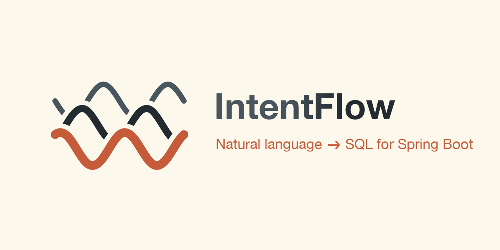

<p align="center">
  
</p>

<p align="center">
  <a href="https://central.sonatype.com/artifact/io.github.serfom256/intentflow-spring-boot-starter"></a>
  <a href="LICENSE"></a>
  
  
</p>

**IntentFlow** answers plain-language questions with your own entity classes. *"Apple laptops under 2000, best
rated first"* returns a `List<Product>`.

The LLM never writes SQL. It writes a small query language (DSL) that IntentFlow validates against your catalog and
compiles into parameterized SQL. Your persistence layer (JDBC, Spring Data JDBC, JPA, Jimmer, OpenMapper or Spring
Data Cassandra) maps the rows.

## Contents

- [How it works](#how-it-works)
- [Quick start](#quick-start)
- [Declaring entities](#declaring-entities)
- [Querying](#querying)
- [Query DSL](#query-dsl)
- [Relations](#relations)
- [Aggregations and top rows](#aggregations-and-top-rows)
- [Limitations](#limitations)
- [Modules](#modules)
- [How SQL is generated](#how-sql-is-generated)
- [Debugging](#debugging)
- [Cassandra](#cassandra)
- [Admin UI](#admin-ui)
- [Adding a database](#adding-a-database)
- [Releasing](#releasing)
- [Configuration](#configuration)
- [Example application](#example-application)

## How it works

```
"apple laptops under 2000"
  → LLM:       products | filter brand == "apple" and category == "laptop" and price < 2000
  → validate:  declared fields only, type checks, allowed values
  → compile:   SELECT * FROM "product" WHERE LOWER("brand") = LOWER(?) AND ... LIMIT 50
  → execute:   List<Product>, mapped by your persistence layer
```

Translations are cached, so a repeated question skips the LLM. When the LLM writes a query that does not parse or
validate, it is shown the error and asked for a corrected one, up to `intentflow.llm.max-repairs` times.

## Quick start

Requirements: Java 21+, Spring Boot 3.2+ or 4.x, an OpenAI-compatible chat API (OpenAI, LM Studio, Ollama, ...).

**1. Add the starter, one executor and one dialect:**

```kotlin
dependencies {
    implementation("io.github.serfom256:intentflow-spring-boot-starter:0.3.1")
    implementation("io.github.serfom256:intentflow-jdbc:0.3.1")
    implementation("io.github.serfom256:intentflow-postgresql:0.3.1")
}
```

The executor maps rows onto entities, the dialect writes engine-specific SQL; see [Modules](#modules). IntentFlow
brings no Spring, ORM or driver of its own and uses the versions your application has.

**2. Point it at an LLM:**

```yaml
intentflow:
  llm:
    base-url: http://localhost:1234/v1
    model: qwen/qwen3.8-27b
```

**3. Mark an entity as queryable:**

```java
@IntentService(value = "products", uri = "/products/{{id}}", defaultSort = "id")
public record Product(
        @IntentField long id,
        @IntentField String name,
        @IntentField BigDecimal price,
        @IntentField Category category) {
}
```

**4. Ask:**

```java
List<Product> products = pipeline.resolve(IntentRequests.of(question), Product.class).items();
```

`IntentPipeline` is auto-configured. Queries run on your `DataSource` or `CqlSession`; every auto-configured bean
can be replaced by your own.

## Declaring entities

`@IntentService` makes a class queryable. `@IntentField` shows a field to the LLM. Fields without it are left out
of the prompt and rejected in queries, but are still loaded into the returned entities, so keep sensitive data out
of your API responses yourself.

IntentFlow annotations sit next to your mapper's own:

```java
@Entity
@Table(name = "product")
@IntentService(value = "products", uri = "/products/{{id}}", defaultSort = "id",
        description = "Items sold in the shop")
public class Product {
    @Id 
    @IntentField 
    Long id;
    @IntentField(description = "retail price in USD") 
    BigDecimal price;
    @IntentField Category category;
    @Column(name = "created_at") 
    @IntentField 
    OffsetDateTime createdAt;
    @Column(name = "supplier_cost") 
    BigDecimal supplierCost;
}
```

- **Types** come from the Java type: text, number, boolean or timestamp. Enum constants become the allowed values
- **Column names** come from your mapper's annotations (`@Column`, `@Field`) or default to snake_case
- **`description`** tells the LLM what a service or field means; good descriptions are the main lever for
  answer quality
- **`caseSensitive = true`** compares `==`, `!=` and `in` exactly, which suits codes and keys
- **`uri`** is the link returned with each answer, filled from the first result
- **`defaultSort`** is appended to every sort as a tie-breaker; end it with a unique field so paging is stable

Interface entities, such as Jimmer's, put `@IntentField` on their property methods. The catalog can also be built
in code with `ServiceDescriptors` and `ServiceCatalogs`.

## Querying

```java
IntentResponse<Product> response = pipeline.resolve(IntentRequests.of("out of stock monitors"), Product.class);
```

The scoped form above shows the LLM only `Product`'s service and the services it relates to. The unscoped form lets
the LLM pick the service; `response.type()` tells which entity came back:

```java
IntentResponse<?> response = pipeline.resolve(IntentRequests.of("vip customers who joined this year"));
```

| Method          | Contents                                                                       |
| --------------- | ------------------------------------------------------------------------------ |
| `items()`       | The entities, in query order; empty for an aggregation                          |
| `aggregation()` | Rows of an aggregate query, otherwise `null`                                    |
| `uri()`         | The `uri` template filled from the first item, e.g. `/products/12`, or `/products` |
| `trace()`       | The DSL, whether it was cached, the SQL and its parameters                      |

Only the question → DSL translation is cached; every call runs the query. Failures are unchecked exceptions:

| Exception                     | Raised when                                                  | Typical HTTP status |
| ----------------------------- | ------------------------------------------------------------ | ------------------- |
| `UnsupportedRequestException` | the LLM declined the question; `reason()` says why           | 422                 |
| `ValidationException`         | the DSL uses an unknown field or the wrong type              | 422                 |
| `DslParseException`           | the LLM's answer is not valid DSL                            | 422                 |
| `ServiceNotFoundException`    | the DSL addresses an unknown or out-of-scope service         | 422                 |
| `ScanLimitExceededException`  | a Cassandra query read too many rows                         | 422                 |
| `LlmException`                | the LLM failed, timed out or returned nothing                | 503                 |

## Query DSL

Each query addresses one service:

```
products | filter category in ("laptop", "phone") and price < 1000 | sort rating desc | take 5
customers | filter vip == true and not (created_at < "2026-01-01")
```

| Stage    | Syntax                                                                            |
| -------- | --------------------------------------------------------------------------------- |
| `filter` | `==` `!=` `<` `<=` `>` `>=`, `~` (contains), `in (...)`, `== null`, `and/or/not`  |
| `sort`   | `sort field [asc\|desc], ...`                                                     |
| `skip`   | `skip 20`                                                                         |
| `take`   | `take 10`, at most the service's `maxTake`                                        |
| `group`  | `group status, category`, then `count`, `sum f`, `avg f`, `min f` or `max f`      |
| `top`    | `top 3 per category by rating desc`                                               |

- Text comparisons ignore case unless the field is `caseSensitive`
- NULLs sort last in both directions
- `!=` and `not (...)` keep rows where the field is NULL: `status != "paid"` also returns orders without a status,
  as a person asking would expect. Use `and status != null` to leave them out
- A date without a time means the whole day: `created_at == "2026-10-10"` matches any time that day, from midnight
  in `intentflow.time-zone`
- `in (...)` takes at most `intentflow.max-in-values` values
- If a question, or any part of it, can't be expressed with the catalog, the LLM declines instead of answering a
  narrower question

**Expressions** work wherever a field does:

```
orders | filter coalesce(discount, 0) > 10 and total / items_count > 1000
orders | filter year(created_at) == 2025 and code::bigint > 1000
orders | group date_trunc("month", created_at) | sum total * 1.2
```

| Kind        | Syntax                                                                 |
| ----------- | ---------------------------------------------------------------------- |
| Arithmetic  | `+` `-` `*` `/`, parentheses; division by zero gives NULL              |
| Casts       | `cast(x as number\|integer\|text\|timestamp\|date)`, `x::bigint`, `x::date` |
| Null        | `coalesce(a, b, ...)`, `expr == null`                                  |
| Date & time | `year`, `month`, `day`, `hour`, `date_trunc("month", t)`               |
| Text        | `length`, `lower`, `upper`                                             |
| Numbers     | `round(n)`, `round(n, digits)`, `abs(n)`                               |

Expressions are type-checked before any SQL is generated, and values are always bound as parameters.

## Relations

Relations come from your ORM model, so ORM entities need no extra annotations:

| ORM        | Read from                                                      |
| ---------- | -------------------------------------------------------------- |
| JPA        | `@ManyToOne`, `@OneToOne`, `@OneToMany(mappedBy)`, `@JoinColumn` |
| Jimmer     | `@ManyToOne`, `@OneToOne`, `@OneToMany(mappedBy)`, `@JoinColumn` |
| OpenMapper | `@Joined(joinBy, to)`                                          |

A relation is named after its property, and its target must be an `@IntentService` too. Plain records declare the
link themselves:

```java
@IntentRelation(name = "customer", service = "customers", from = "customer_id", to = "id")
public record Order(@IntentField long id, @IntentField long customerId, @IntentField String status) {
}
```

Queries use the related fields as `<relation>.<field>`, and still return the same entities:

```
orders | filter customer.vip == true and status == "delivered"
customers | filter orders.total > 100 and orders.status == "PAID"
customers | filter not (orders.status == "CANCELLED")
orders | sort customer.name
```

A relation condition means "some related row matches" and becomes an `EXISTS` subquery, so rows are never
duplicated; `not (...)` means "no related row matches". Conditions on one relation within an `and` apply to the same
related row.

Your ORM still loads the entities, so associations behave as usual:

- **JPA (Hibernate)** loads the matching ids with JPQL. A named entity graph `<Entity>.intentflow` decides which
  associations arrive initialized:
  `@NamedEntityGraph(name = "Order.intentflow", attributeNodes = @NamedAttributeNode("customer"))`
- **Jimmer** uses a `Fetcher` bean per entity type, e.g.
  `OrderFetcher.$.allScalarFields().customer(CustomerFetcher.$.allScalarFields())`
- **OpenMapper** fills `@Joined` fields with one extra query per association, `WHERE <to> IN (...)` over the keys
  of the page, never one per row. The target's restriction applies, a back-reference points to the already loaded
  parent, and only the first level is loaded (the children's own `@Joined` fields stay empty)

## Aggregations and top rows

```
orders | group status | count
products | group category | avg price | sort avg desc | take 3
```

`response.aggregation().rows()` holds one row per group: the group values and the result, numbers as `BigDecimal`.
Rows are ordered by the result, largest first, unless the query sorts them.

`top` keeps the first rows of every group and still returns entities, for questions like "the latest order of every
customer":

```
products | top 3 per category by rating desc
orders | filter status == "PAID" | top 1 per customer_id by created_at desc
```

## Limitations

IntentFlow answers questions about the records of one service. Anything else is declined or rejected, never turned
into ad-hoc SQL. Not supported:

- Results other than entities of one service or one aggregate: no columns from several tables, no `UNION`; the SQL
  is always a read-only `SELECT`
- Relations more than one hop away (`customer.address.city`), "every related row" conditions, and counts or sums
  over related rows ("customers with more than 3 orders")
- Grouping by related fields, or using them in expressions
- More than one aggregate function per query, `COUNT(DISTINCT ...)`, percentiles, and conditions on the aggregate
  (`HAVING`)
- Window functions other than `top`: `RANK`, `LAG`/`LEAD` and running totals produce new columns, not entities
- `CASE`, string concatenation, regular expressions, "starts with"/"ends with". Relative dates ("last 3 months")
  are turned into dates by the LLM
- Questions about the person asking ("my orders", "near me"); there is no request context yet
- Relations on Cassandra

## Modules

**Executors** run the SQL and map rows onto entities. With several on the classpath, the first one in the table wins;
`intentflow.executor` picks one explicitly.

| Module                             | Maps rows with                                               |
| ---------------------------------- | ------------------------------------------------------------ |
| `intentflow-openmapper`            | OpenMapper `Procedures`                                      |
| `intentflow-jpa`                   | JPA: ids first, then JPQL with an optional entity graph      |
| `intentflow-jimmer`                | Jimmer: ids first, then `findMapByIds` with an optional `Fetcher` |
| `intentflow-spring-data-jdbc`      | Spring Data JDBC entity mapping                              |
| `intentflow-spring-data-cassandra` | Spring Data Cassandra converter                              |
| `intentflow-jdbc`                  | Spring `JdbcClient`: records, JavaBeans, Lombok `@Value`     |

**Dialects** write engine-specific SQL. The starter detects the database from the JDBC URL; `intentflow.dialect`
overrides it.

| Module                  | Databases         |
| ----------------------- | ----------------- |
| `intentflow-postgresql` | PostgreSQL, H2    |
| `intentflow-mysql`      | MySQL 8+, MariaDB |
| `intentflow-cassandra`  | Cassandra 5       |

The build is tested against Spring Boot 3.2, 3.5 and 4.0. Spring Boot 3.0 and 3.1 are not supported, because the
JDBC executors need `JdbcClient` (Spring Framework 6.1).

## How SQL is generated

The validated query becomes a small plan (`Select`, `SqlPredicate`, `SqlExpr` in `core.sql.plan`), which
`SqlRenderer` writes for the configured dialect. The planners decide what the query means; the dialect only decides
how it is spelled.

**Schema facts.** At startup IntentFlow learns about your tables from three sources; the first that knows a fact
wins:

1. The database: primary keys, unique indexes, NOT NULL columns
2. The ORM: `@Id`, `@Column(nullable = false)`, Jimmer's non-null properties, OpenMapper's primary key
3. The Java model: primitives are NOT NULL, enums store their constant names, except JPA enums without
   `@Enumerated(STRING)`, which store ordinals: they are compared as numbers and shown by name

`intentflow.schema.introspect=false` skips the database. Anything unknown is assumed the safe way (nullable, not
unique), which gives plain, conservative SQL.

**Optimizations** apply only when they can't change the result. `trace().optimizations()` lists the ones used, and
`intentflow.sql.disabled-optimizations` switches them off:

| Optimization        | Effect                                                                      |
| ------------------- | --------------------------------------------------------------------------- |
| `date-ranges`       | `year(t) == 2025` becomes a range on `t`, so an index on `t` applies        |
| `not-null-ordering` | no `NULLS LAST` on NOT NULL columns, so an index can serve the sort         |
| `exact-values`      | enums compare as `status = 'PAID'` instead of `LOWER(...)`                  |
| `to-one-join`       | sorting by a to-one relation uses a `LEFT JOIN` instead of a subquery per row |
| `key-projection`    | JPA and Jimmer get only the primary keys, then load the entities themselves |

**Restrictions.** A condition every row of a service must meet, such as a soft delete, is added to every query of
that service, including counts and relation subqueries. It comes from Hibernate's `@SQLRestriction`, Jimmer's
`@LogicalDeleted`, or `@IntentService(restriction = "deleted_at IS NULL")`.

**Schemas.** Tables may be schema-qualified: `@IntentService(table = "billing.invoice")` or JPA's
`@Table(schema = "billing")`.

**Time zones.** Dates are bound as typed values, never as text the database interprets in its session zone. A
column that stores an instant (PostgreSQL `timestamptz`, MySQL `TIMESTAMP`, or a Java `Instant`, `OffsetDateTime`
or `ZonedDateTime`) gets an `OffsetDateTime` in `intentflow.time-zone`; any other timestamp gets the local date and
time. On PostgreSQL, `year(t)`, `hour(t)` and `date_trunc` of an instant column are taken in that zone too. MySQL
takes them in the session's zone, so keep it equal to `intentflow.time-zone`.

**Inheritance and filters.** A service on a JPA subclass in single-table inheritance sees only rows of that
class and its subclasses (`DTYPE IN (...)`). Hibernate `@Filter`s enabled on the current session are added to the
query with their parameters bound, as Hibernate would for its own queries. Another executor can add such
session-dependent conditions through `QueryExecutor.restrictions`.

## Debugging

- `response.trace()` gives the DSL, the SQL and its parameters; the SQL runs as-is in `psql` or `mysql`
- `pipeline.explain(request)` returns the same trace without running the query
- `logging.level.io.github.serfom256.intentflow=DEBUG` logs every step: cache hit or LLM call, the DSL, declined or
  rejected answers with the reason, the SQL and the result count

## Cassandra

CQL can't express most of the DSL (`or`, `not`, `!=`, contains, sorting on arbitrary columns), so a Cassandra query
runs in two steps. Conditions CQL can evaluate exactly are sent with `ALLOW FILTERING` to narrow the scan; the full
filter, `top`, sorting, paging and aggregation then run in memory, so results match SQL. A query reading more than
`intentflow.cassandra.max-scanned-rows` rows fails with `ScanLimitExceededException`. Timestamps are read as UTC.

## Admin UI

`intentflow-admin-spring-boot-starter` adds a web UI for editing descriptions and paths at runtime, without a
redeploy, and for trying questions against the live catalog. See the [admin README](intentflow-admin-spring-boot-starter/README.md).

## Adding a database

A SQL dialect is a module with three parts:

1. A `SqlDialect`: quoting, contains, timestamps, null ordering, casts, date functions and paging.
   `PostgresDialect` and `MySqlDialect` are complete examples of about 100 lines. `capabilities()` declares what
   the database lacks (window functions, native booleans) and its limits (`in` list size, bound parameters), so a
   query it cannot run is rejected with a clear message instead of failing in the database
2. A `META-INF/services/io.github.serfom256.intentflow.core.pipeline.SqlDialect` entry
3. A test extending `DialectConformanceTest` that returns your `TestDatabase` (a Testcontainers container)

The conformance test runs thousands of random queries against the real database and compares every result with an
independent in-memory evaluation. `ExpectedSqlTest` pins the SQL of about 60 queries per dialect in `src/test/resources/expected-sql`, so any change to the
generated SQL shows up as a readable diff.

## Releasing

The version lives only in `gradle.properties`. After changing it, `./gradlew syncVersion` writes it into the READMEs
and the UI packages; `./gradlew build` fails while they are out of date.

## Configuration

| Property                              | Default                     | Description                                         |
| ------------------------------------- | --------------------------- | --------------------------------------------------- |
| intentflow.enabled                    | true                        | Turns the auto-configuration on or off              |
| intentflow.llm.base-url               | http://localhost:1234/v1    | OpenAI-compatible API                               |
| intentflow.llm.model                  | -                           | Model id; required unless you define an `LlmClient` |
| intentflow.llm.api-key                | empty                       | Bearer token; empty for local servers               |
| intentflow.llm.timeout                | 60s                         | Timeout of one LLM call                             |
| intentflow.llm.max-repairs            | 1                           | Retries with the error when a query is rejected     |
| intentflow.cache.ttl                  | 10m                         | How long a translation is cached                    |
| intentflow.cache.max-size             | 10000                       | Maximum cached translations                         |
| intentflow.catalog.packages           | your application's packages | Where `@IntentService` classes are scanned          |
| intentflow.executor                   | first available             | `openmapper`, `jpa`, `jimmer`, `spring-data-jdbc`, `cassandra` or `jdbc` |
| intentflow.dialect                    | detected                    | `postgresql` or `mysql`                             |
| intentflow.max-skip                   | 10000                       | Largest `skip` a query may use                      |
| intentflow.max-in-values              | 1000                        | Most values in one `in (...)`                       |
| intentflow.time-zone                  | the JVM's zone              | Zone for dates without an offset, e.g. `Europe/Berlin` |
| intentflow.schema.introspect          | true                        | Read keys and NOT NULL columns from the database    |
| intentflow.sql.disabled-optimizations | empty                       | Optimizations to switch off                         |
| intentflow.cassandra.max-scanned-rows | 10000                       | Rows one Cassandra query may read                   |

## Example application

[`intentflow-examples`](intentflow-examples) is a complete shop: a Spring Boot API with natural-language search, a
React UI, the admin UI, and a Docker Compose setup for PostgreSQL, MySQL and Cassandra. It runs on OpenMapper, JPA,
Jimmer or plain JDBC, chosen by a Spring profile, so you can compare how each declares the same entities.
