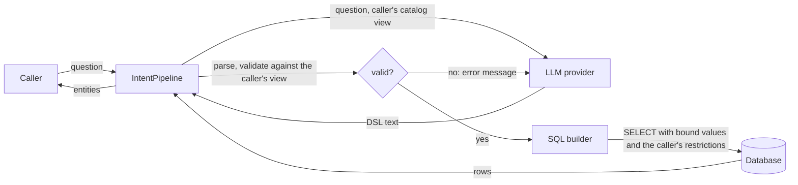

# Security model

IntentFlow lets people query a database in plain language. The language model in the middle is the part an attacker
can steer most easily: anyone who can type a question can try to talk it into producing something harmful. So
IntentFlow treats everything the model returns as untrusted input and never lets it reach the database directly.

**The guarantee:** whatever the question and whatever the model answers, a caller can only run a read-only query
over the services and fields their `AccessPolicy` lets them query, and only over the rows their restrictions allow.
The worst a manipulated model can do is answer a question wrongly, with data the caller could already see.

This guarantee rests on your `AccessPolicy` and on the catalog you declare. IntentFlow enforces them, but it cannot
tell when they are too permissive.

## Trust boundaries

| Input                                          | Trusted? | Why                                                              |
| ---------------------------------------------- | -------- | ---------------------------------------------------------------- |
| Your code: `@IntentService` classes, `AccessPolicy`, `@IntentService(restriction = ...)` SQL | Yes | Written and reviewed by your team |
| The caller (`IntentContext` from Spring Security, an `IntentContextProvider`, or the request) | Yes, as far as your authentication is | IntentFlow does not authenticate anyone itself |
| Catalog descriptions edited in the admin UI    | Partly   | Editors change what the model reads, but not what the validator allows |
| The question text                              | No       | Typed by the end user                                            |
| The model's answer (the DSL)                   | No       | Steerable through the question (prompt injection), or by a compromised provider |
| Page cursors (`IntentRequests.page`)           | Only with a valid signature | Sent back by the client, so they can be edited               |
| The LLM provider                               | For confidentiality only | It receives questions and the catalog, never rows |

## Data flow

What leaves your application, and where it goes:

| Destination      | What it receives                                                                      | What it never receives |
| ---------------- | ------------------------------------------------------------------------------------- | ---------------------- |
| LLM provider     | The question; the services, fields, relations, descriptions and allowed values the caller may query; the `AccessPolicy.scope` text; today's date. On a repair, the rejected DSL and the validator's message | Rows, query results, SQL, restriction values, hidden services and fields, database credentials |
| Database         | One parameterized `SELECT` per question, plus one per loaded relation                 | Text from the question or the model, except as bound parameter values |
| DSL cache (memory) | Normalized question → DSL, per service and caller view                              | Rows |
| Application log  | Stages and timings. Questions, DSL literals, bind values and LLM bodies only with `intentflow.logging.values=true` | API keys |
| Audit log (`intentflow.audit`, opt-in) | Principal, tenant, question, DSL, SQL, row count, tokens, outcome; who changed which description | Bind values, rows |

Allowed values sent to the model come from your code (`@IntentField(values = ...)` and enum constants), never from
table contents. Schema introspection (`intentflow.schema.introspect`) reads keys and `NOT NULL` columns, never rows.

## Controls

### Access

`AccessPolicy` is applied once per request and builds the caller's view of the catalog:

- `canQuery` hides a whole service. A hidden service is not in the prompt, and a query naming it is rejected.
  Relations to hidden services disappear too.
- `canSee` hides a field. The model is not told about it, and the validator rejects a filter, sort or group on it.
- `restrictions` adds conditions to every query of the service, including relation subqueries, for every executor.
  Values are bound parameters. `RuntimeRestriction.equalTo(column, null)` matches no rows, so a missing caller
  attribute fails closed.
- `scope` tells the model in words which rows the caller sees, so "my orders" needs no filter. It changes the
  prompt only; the restriction does the limiting.

With `intentflow.results.visible-fields-only=true`, returned entities are copies with only the fields the caller may
see; the rest are `null`. Without it, the entities are returned as your executor loads them.

### Validation of the model's answer

The DSL has no way to express anything but a read. Its grammar has filters, sorting, grouping, aggregates, `top`,
`skip` and `take`, and nothing that writes, calls functions outside a fixed list, or names a table. The validator
then checks the parsed query against the caller's view:

- every service, field and relation must be in the view;
- values must match the field's type, and its allowed values when it has a list;
- `take` and `top` are limited by the service's `maxTake` (default 50), `skip` by `intentflow.max-skip`, `in (...)`
  by `intentflow.max-in-values`; without a `take`, the query returns at most `maxTake` rows;
- expressions may nest about 30 levels deep and use at most 200 operators, so no answer can exhaust the stack of
  the parser, the validator or the SQL renderer.

Questions longer than `intentflow.max-question-length` (2000 characters) are rejected before the model is called.

A rejected answer goes back to the model once (`intentflow.llm.max-repairs`) with the validator's message, and then
fails with `ValidationException`.

### SQL generation and execution

- Column and table names come from the catalog, never from the DSL text. Every value from the DSL is a bound
  parameter.
- Generated queries run in a read-only transaction (`intentflow.sql.read-only`, default `true`) with a statement
  timeout (`intentflow.sql.statement-timeout`, default 30 seconds). Cassandra queries stop after
  `intentflow.cassandra.max-scanned-rows`.
- `@IntentService(restriction = "...")` and `RuntimeRestriction.of(sql)` are raw SQL from your code. Never build them
  from caller input; use `equalTo` and `in`, which bind values.

### The model and its cost

- Rate limits per principal or tenant (`intentflow.llm.rate-limit.*`) count questions that reach the model; cached
  questions are free. With several instances, use a shared store (`intentflow-ratelimiters`).
- A concurrency limit, a circuit breaker and a fallback model keep a slow or failing provider from tying up threads.
- LLM request and response bodies are not logged unless `intentflow.logging.values=true`.

### Cache

A cached translation is keyed by the normalized question, the service, and a fingerprint of the caller's view, so
callers with different policies do not share entries. A cache hit is still parsed, validated against the current
caller's view and given the current caller's restrictions, so even a wrong cache entry cannot widen access.

### Page cursors

A cursor holds a hash of the question, the translated query, and either an offset or the last row's sort values,
signed with HMAC-SHA256 and `intentflow.paging.cursor-key`. It is not encrypted: the client can read the query and
values from a row the caller already received.

- With a valid signature, the next page runs the query from the cursor without asking the model. The query is
  still validated against the current caller's view and gets the current caller's restrictions, so a cursor handed
  to someone else shows them only what they may see, and a cursor whose query their access no longer allows is
  rejected with `intentflow.invalid-cursor`.
- Without a valid signature (edited, or signed with another instance's key), the question is translated again and
  the cursor is accepted only if the translation is the same query. A client therefore cannot use a cursor to run a
  query of its own.
- A cursor from another question is rejected. An offset in a cursor is held to `intentflow.max-skip` like any
  `skip`; keyset cursors have no offset and page without limit.

Treat the cursor key like any other secret: whoever holds it can sign cursors with queries of their choice, though
those still run only within the caller's access.

### Admin UI

The admin edits descriptions and URIs, which change the prompt. It is protected by default: with Spring Security,
only `intentflow.admin.security.authorities` may edit and `read-only-authorities` may look; without it, HTTP Basic with
a generated password. Editors cannot make a hidden field visible or change what the validator accepts. Every change is
recorded with the user when the audit log is on.

## Threats

| Threat                                                         | Mitigation                                                     | What remains |
| -------------------------------------------------------------- | -------------------------------------------------------------- | ------------ |
| A question tells the model to read another tenant's or user's rows | Restrictions are added in SQL, outside the model's reach   | A policy that forgets a service or a relation target |
| A question tells the model to modify or drop data ("SQL injection through the LLM") | The DSL cannot express writes; values are bound; read-only transaction | A database user with write rights, if the read-only flag is turned off |
| The model is asked about hidden fields or services             | They are not in the prompt, and the validator rejects them     | Field names in descriptions you write yourself |
| A question asks for huge or slow results                       | `maxTake`, `max-skip`, `max-in-values`, statement timeout, scanned-row limit | Expensive queries within those limits, such as a filter on an unindexed column |
| Running up the model bill                                      | Rate limits, the DSL cache, concurrency limit, question length limit | Many short questions within the rate limit |
| Questions and catalog details reach the provider               | Only the caller's view is sent, never rows                     | The questions themselves, which may contain personal data; choose the provider and region accordingly |
| Sensitive values in logs                                       | Masked by default                                              | The audit log stores questions in clear text by design |
| A compromised provider returns crafted DSL                     | Same validation as any model answer, with nesting and size limits | Wrong answers within the caller's access |
| An admin editor writes instructions into a description         | Descriptions only steer the model; the validator still applies | Wrong answers for every caller until the change is reverted |
| A client edits a page cursor                                   | HMAC signature, question check, `max-skip`, validation and restrictions on every page | Jumping to another page of the same results |

## Your checklist

1. Connect with a database user that may only `SELECT` the tables in the catalog. The read-only transaction is a
   second line of defence, not the first.
2. Write an `AccessPolicy` whenever different callers may see different rows. Restrict every service that holds
   tenant or personal data, including services reachable only through relations.
3. Expose only the fields people should query: fields without `@IntentField` are invisible, and `queryable = false`
   keeps a field out of filters while URI templates can still use it.
4. Turn on the audit log (`intentflow.audit.enabled`) and decide how long questions are kept.
5. Set a rate limit (`intentflow.llm.rate-limit.questions`), with a shared store when you run several instances.
6. Keep `intentflow.logging.values` off in production.
7. Pick a provider and region your data protection rules allow for the questions people will type; a self-hosted
   model keeps questions inside your network.
8. Restrict the admin UI to the people who own the catalog, and give everyone else read-only access.
